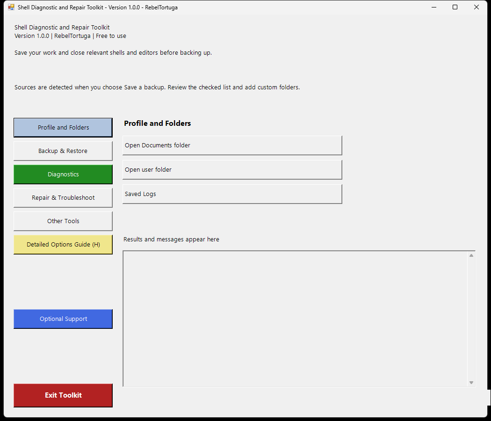

# Shell Diagnostic and Repair Toolkit

**Developer:** RebelTortuga  
**Platform:** Windows 10 / Windows 11  
**Version:** 1.0.0  
**Cost:** Free to use. No payment is required.

Back up shell configuration and project folders, check locally available shell tools, and verify saved backup
files. The interface follows the Firefox and WoW toolkits: section buttons on the left, actions on the right,
and results below the actions.

## Screenshot

## Start Here

1. Extract all ZIP contents into a new folder.
2. Double-click **Shell Diagnostic and Repair Toolkit.bat**. **Start.cmd** remains a compatible shortcut.
3. Open **Diagnostics** and run **Check shell tools and common folders**.
4. Save your work and close relevant shells and editors.
5. Choose **Backup & Restore → Save a backup**, review the checked sources, and use **Add Folder** for custom locations.
6. Choose a destination outside every selected source folder, preferably on an external drive. Wait for the completion message.
7. Choose **Diagnostics → Verify a backup** and select the dated backup folder.

No browser profile selection is needed. This toolkit works with folders for the current Windows user. The
backup picker opens as a separate dialog. The launcher hides the PowerShell console; the main toolkit remains
open. The explicit no-profile troubleshooting action opens a visible test shell that you close separately.

## Buttons and Layout

| Section | Actions |
| --- | --- |
| Profile and Folders | Open Documents; open user folder; saved logs |
| Backup & Restore | Save a backup; manual restore guide; open existing backup |
| Diagnostics — green | Check shell tools and common folders; verify a backup; export last report |
| Repair & Troubleshoot | Open Windows PowerShell without a profile; manual restore guide; troubleshooting guidance |
| Other Tools | Verify a backup; feedback and GitHub information |
| Detailed Options Guide (H) | Yellow; opens OPTIONS-README.md |
| Optional Support | Blue; optional Ko-fi support with confirmation |
| Exit Toolkit | Red with white text; closes the toolkit |

**Diagnostics stays green**, and **Optional Support stays blue**, including after switching sections. The guide sits directly below Other Tools. Optional Support has equal spacer rows above and below it, between the guide and Exit. Results and messages have a label above their box. Actions disable navigation and Exit until they return. Long operations can pause the interface; progress cancellation is not implemented.

## Backup Coverage
The source picker looks for:

- PowerShell and Windows PowerShell profile, module, and script folders, including redirected Documents.
- Clink configuration and its installation when found on PATH.
- Common Oh My Posh configuration and theme locations.
- Quoted local theme paths referenced by profile scripts.
- Common project and script folders.
- Windows Terminal settings.

Review the list: custom locations are not guaranteed to be detected. Add them yourself.

Selected folders are copied in full, including hidden files and Git metadata. Linked junction targets are
excluded; add their actual target folders separately. History, private scripts, credentials and large project
files may be included. System-wide modules, Windows binaries, fonts, WSL and complete installed applications
are not automatically covered. This is not a Windows system image or package installer.

Each dated backup also exports existing current-user CMD AutoRun, Console and Clink registry keys, and
selected user environment variables. It includes **Restore Map.json**, **Copy Log.txt**, **Backup
Summary.txt**, **File Checksums.csv** and **Backup Complete.json**. Failures do not create the completion
marker. Existing backups are not overwritten. Backups are not encrypted: keep them private.

## Restore and Verification

### Manual Restore
Restore is manual in Version 1.0.0. The restore button opens the detailed guide; it does not automatically
change files, registry settings or environment variables. Follow [OPTIONS-README.md](OPTIONS-README.md) to
review original locations and copy files safely.

### Backup Verification
Verification checks the completion format and each listed file's size and SHA-256 hash. Missing or changed
files fail verification. Extra files are not checked. Matching hashes do not prove authenticity, completeness
of source selection or compatibility with another computer.

## Requirements and Logs
Windows PowerShell 5.1, Windows Script Host, Robocopy and Registry tools included with Windows are used.
PowerShell 7, Git, Python and administrator rights are not required. Access-restricted sources can still fail.
Execution-policy bypass applies only to the launched process and does not change system policy.

Session logs: `%LOCALAPPDATA%\RebelTortuga\Shell-Toolkit\Logs`. Diagnostics and verification reports are
exported only when requested. Reports can contain usernames and paths: review them before sharing.

## Feedback and Optional Support

### Bugs and Feature Requests
Use this repository's Issues tab for bugs, cleanup suggestions, additional options and feature requests.
Include Windows version, selected action, reproduction steps and exact error text. Never publish backups,
scripts containing secrets or private configuration. No repository URL has been confirmed, so no guessed link
is included.

### Optional Support
collected and no features require payment. A confirmed link can be added to both the toolkit and README later.
Bug reports, ideas and sharing the project are welcome too.

## Included Files

| File | Purpose |
| --- | --- |
| `ShellToolkit-Sidebar.ps1` | Graphical interface, diagnostics and backup verification |
| `ShellBackup.ps1` | Source selection and backup engine |
| `Shell Diagnostic and Repair Toolkit.bat` | Main launcher |
| `Launch-Toolkit.vbs` | Starts the graphical toolkit with the console hidden |
| `Start.cmd` | Compatible alternate launcher |
| [README.md](README.md) | Overview and getting started |
| [RUN-README.md](RUN-README.md) | Launch instructions and download blocking help |
| [OPTIONS-README.md](OPTIONS-README.md) | Complete action guide and manual restore instructions |
| [CHANGELOG.md](CHANGELOG.md) | Version 1.0.0 release changes |

## Frequently asked questions and troubleshooting

**What is the safest first action?** Run **Diagnostics → Check shell tools and common folders**, then choose the backup sources you want to save.

**Where should I save backups?** Choose a destination outside every selected source folder, preferably on another drive. Avoid placing the backup inside a folder that is being backed up.

**Does Restore automatically overwrite my files?** No. Follow the documented **Manual Restore** procedure and review destinations before copying files.

**How do I know a backup succeeded?** After the completion message, use **Diagnostics → Verify a backup** against the dated backup directory.

**Why did a separate PowerShell window open?** The no-profile diagnostic starts a visible test shell. It is separate from the graphical toolkit and can be closed when finished.

## 🔗 Related Free RebelTortuga Projects

Explore other free tools and workflows:

- [wow-diagnostic-and-repair-toolkit](https://github.com/RebelTortuga/wow-diagnostic-and-repair-toolkit)
- [firefox-diagnostic-and-repair-toolkit](https://github.com/RebelTortuga/firefox-diagnostic-and-repair-toolkit)
- [brave-diagnostic-and-repair-toolkit](https://github.com/RebelTortuga/brave-diagnostic-and-repair-toolkit)

[Browse all RebelTortuga projects](https://github.com/RebelTortuga)

## 🐢 Support RebelTortuga

All features are free. A donation is never required and does not unlock anything.

**[☕ Help this turtle get a new shell on Ko-fi!](https://ko-fi.com/rebeltortuga)**

The in-app **Optional Support** button asks before opening the same page in your browser. The toolkit does not collect payment information.

## License

MIT; see [LICENSE](LICENSE).
